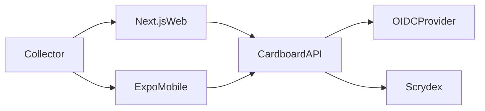
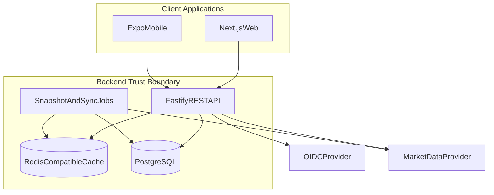

# Architecture Design

## Context

Cardboard is a multi-client portfolio service. Browser and native clients call one versioned API. The API owns authorization and persistence and is the only component allowed to call market-data and identity providers with secrets.

## Containers

## Repository

- `apps/web`: responsive Next.js application.
- `apps/api`: Fastify API, OpenAPI document, authorization, provider adapters, and jobs.
- `apps/mobile`: Expo application delivered after web acceptance.
- `packages/contracts`: transport schemas and generated/shared TypeScript types.
- `packages/domain`: exact money, valuation, and portfolio rules without framework dependencies.
- `packages/config`: shared TypeScript and lint configuration.
- `packages/test-data`: deterministic catalog, identities, and prices.

## API conventions

- Base path: `/v1`; JSON request and response bodies.
- Validation uses shared schemas. Unknown fields are rejected on write.
- Errors use RFC 9457-style problem details with stable `type`, `title`, `status`, and `requestId`.
- Protected handlers derive the user from verified authentication. They never accept a user ID as authority.
- Mutating collection endpoints support `Idempotency-Key`.
- List endpoints use opaque cursor pagination and bounded page sizes.

## Persistence

PostgreSQL is authoritative for users, catalog records, acquisition lots, prices, snapshots, idempotency records, and audit metadata. Foreign keys, unique constraints, checks, and transactions enforce invariants. Application services add deny-by-default object authorization.

Redis-compatible caching is an optimization, not an authority. Catalog metadata can be cached for days. Market prices are cached for at least 24 hours because Scrydex states they update at most daily. Cache entries include schema version, provider, and observation timestamp.

## Catalog and pricing flow

1. Search queries the normalized local catalog using PostgreSQL full-text and trigram indexes.
2. A controlled synchronization job requests missing or changed provider data.
3. The adapter maps provider-specific data into canonical cards and market variants.
4. Price observations are append-only. A current-price query selects the latest matching variant.
5. Clients receive normalized data plus source, currency, observation time, and freshness.

The development adapter is deterministic and consumes fixtures. A Scrydex adapter cannot be enabled until its contract, quotas, cache rules, image rights, and commercial redistribution permission are recorded.

## Portfolio valuation

Each acquisition lot points to one market variant. The domain service multiplies exact unit market cents by quantity, sums cost basis, and reports missing/stale lines separately. A daily UTC job stores aggregate snapshots. Historical values are not recomputed implicitly when lots change.

## Identity

An `IdentityVerifier` port isolates the API from Clerk, Auth0, or Better Auth. The production implementation must verify issuer, audience, signature, expiry, nonce where applicable, and token type. Web uses secure, HTTP-only, same-site cookies; Expo uses authorization code with S256 PKCE, system browser redirects, universal/app links, and platform secure storage.

## Deployment and operations

- Web: Vercel-compatible deployment.
- API and worker: managed container runtime with separate service identities.
- Data: managed PostgreSQL and Redis-compatible cache with encrypted backups.
- Mobile: Expo EAS.
- Observability: structured logs, request IDs, service metrics, security audit events, and alerts for auth failures, provider-credit exhaustion, job failures, and elevated 4xx/5xx rates.

Secrets are injected by the deployment platform. Production startup validates required configuration and fails closed. Database migrations run as a separate deployment step using a role not available to the runtime service.
