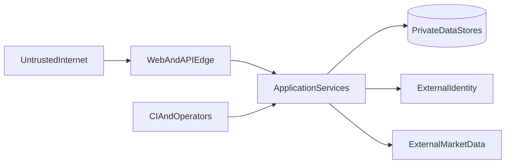

# STRIDE Threat Model

## Scope and method

This living model covers browser/mobile clients, the public API, jobs, PostgreSQL, cache, OIDC providers, market-data providers, CI/CD, and operator access. Threat IDs are referenced by tests and controls. Review on every new trust boundary, provider, sensitive field, or public sharing feature.

## Assets

Account identity and sessions; private portfolio and notes; cost basis; audit evidence; OAuth and market-provider secrets; catalog and pricing integrity; API availability and provider credits; deployment and signing credentials.

## Trust boundaries

## Threat register

### Spoofing

- **S-01, account takeover:** stolen/replayed OAuth callback or token. Controls: authorization code with S256 PKCE, state and nonce, exact redirect URIs, issuer/audience/signature/expiry validation, short sessions, rotation, secure cookie/keychain storage. Verification: callback replay, wrong issuer/audience, expired token, missing state, and token-type tests. Risk after controls: Medium.
- **S-02, unsafe linking:** attacker-controlled identity shares a victim email. Controls: issuer+subject identity key; require authenticated proof of both accounts before linking; never link by email alone. Verification: duplicate-email and provider-confusion tests. Risk: Low.
- **S-03, mock auth in production:** configuration enables arbitrary headers. Controls: environment startup guard and deployment policy. Verification: production configuration test. Risk: Low.

### Tampering

- **T-01, cross-owner mutation:** object ID is changed to another user's lot. Controls: derive owner from verified principal; owner-scoped queries; centralized policy; foreign keys. Verification: negative tenant-isolation tests for every operation. Risk: Low.
- **T-02, price manipulation:** provider/cache payload or stale value changes valuation. Controls: strict normalization, source/timestamp provenance, append-only observations, cache schema/version checks, exact variant matching, stale-price exclusion. Verification: malformed payload, downgrade, stale, and variant-confusion tests. Risk: Medium.
- **T-03, duplicate mutation:** retries create duplicate lots. Controls: owner-scoped idempotency key, request hash, transaction, unique constraint. Verification: concurrent replay tests. Risk: Low.

### Repudiation

- **R-01, disputed portfolio change:** actor denies creating or deleting a lot. Controls: privacy-safe audit event with actor, action, resource ID, result, timestamp, and request ID; protected retention. Verification: audit emission tests. Risk: Low.
- **R-02, operator action is unattributed:** privileged change lacks identity. Controls: individual operator accounts, least privilege, platform audit logs, no shared credentials. Verification: quarterly access review. Risk: Medium.

### Information disclosure

- **I-01, insecure direct object reference:** another collector reads a lot or summary. Controls: deny-by-default authorization and owner-scoped repository methods; no public portfolio endpoints. Verification: tenant matrix integration tests. Risk: Low.
- **I-02, secret/token leakage:** credentials appear in logs, client bundles, or errors. Controls: server-only secrets, structured allowlisted logs, response minimization, secret scanning, redaction. Verification: bundle scan, log tests, and CI secret scan. Risk: Low.
- **I-03, excessive retention/export:** deleted private data remains indefinitely or export leaks another tenant. Controls: retention schedule, owner-scoped export, deletion workflow, encrypted backups with expiry. Verification: export isolation and deletion lifecycle tests. Risk: Medium.

### Denial of service

- **D-01, API exhaustion:** abusive search or expensive queries impair service. Controls: IP/user rate limits, bounded schemas, pagination, statement timeouts, indexes, body limits. Verification: limit and query-plan tests. Risk: Medium.
- **D-02, provider credit exhaustion:** attackers force Scrydex requests. Controls: local-first search, cache, controlled jobs, per-operation budgets, circuit breaker, alerts; no direct user-to-provider proxy. Verification: cache-miss storm and quota tests. Risk: Medium.
- **D-03, job amplification:** snapshots or sync jobs overlap. Controls: distributed lease, idempotent jobs, bounded batches, retry backoff. Verification: concurrent-worker tests. Risk: Low.

### Elevation of privilege

- **E-01, user becomes operator:** hidden or forged role reaches admin behavior. Controls: no MVP admin API, server-side roles from internal records only, separate operator identity. Verification: role-claim injection tests. Risk: Low.
- **E-02, compromised service gains migration power:** runtime credential can alter schema or bypass controls. Controls: separate migration/runtime roles, least privilege, isolated networks, rotated credentials. Verification: deployment permission test. Risk: Medium.
- **E-03, vulnerable dependency or CI injection:** package/build compromise obtains secrets. Controls: lockfile, reviewed updates, dependency and secret scanning, protected CI environments, pinned actions. Verification: CI policy. Risk: Medium.

## Security gates

- Critical or High residual threats block release.
- Every protected route needs positive and negative authorization tests.
- Production may not use mock adapters, wildcard redirects/origins, default secrets, or verbose error stacks.
- Changes to auth, sharing, uploads, AI ingestion, vendor sales, or payments require threat-model review.
- Security owners review this file before each release and record accepted risks in an ADR.
